# LAPORAN PRAKTIKUM 9 PEMROGRAMAN WEB

Nama : Rizky Opras Fernanda  
NIM : 312510101  
Kelas : I252A  
Program Studi : Teknik Informatika  
Mata Kuliah : Pemrograman Web

## Langkah-Langkah Praktikum

Praktikum ini melanjutkan aplikasi CRUD data barang dari Lab 8. Aplikasi dipisahkan ke dalam file-file dengan tanggung jawab jelas, memakai template bersama, function helper, dan routing berbasis parameter.

## Konsep Dasar Pemanggilan File PHP

### Praktik: menguji include dan require

1. Menjalankan uji-include.php dan catat keluarannya.

   Keluaran normal menampilkan "Sebelum pemanggilan", isi pesan.php, lalu "Sesudah pemanggilan".

   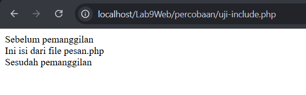

2. Mengubah nama pesan.php sementara, misalnya menjadi pesan1.php, lalu jalankan kembali uji-include.php.

   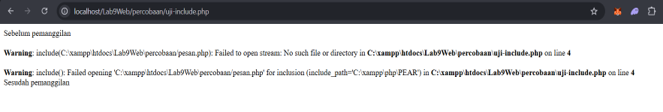

   hasilnya muncul peringatan (warning) "Failed to open stream", tetapi baris "Sesudah pemanggilan" tetap tampil.

3. Mengembalikan nama file, ulangi dengan uji-require.php saat pesan.php tidak ada.

   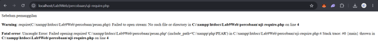

   Hasilnya muncul fatal error "Failed opening required" dan baris "Sesudah pemanggilan" tidak tampil.

## Membuat Template Layout dengan PHP

1. Struktur file awal

   Pada modul, template dibuat dalam bentuk views/header.php dan views/footer.php. Halaman Home, Profil, dan Kontak tidak menulis HTML pembuka dan penutup sendiri. Ketiganya hanya berisi konten khusus halaman. Penggabungan dilakukan oleh index.php dengan urutan: header, konten, lalu footer.

2. Membuat header.php

   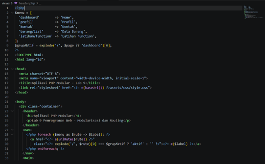

   File header.php berisi deklarasi HTML, meta, judul, tautan CSS, dan navigasi. Navigasi dibentuk dari array $menu sehingga penambahan halaman cukup dilakukan pada satu tempat. Menu yang sedang dibuka diberi kelas aktif berdasarkan grup rute (fitur active navigation pada tantangan mandiri)

3. Membuat footer.php

   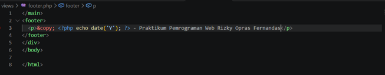

   File footer.php berisi penutup main, footer dengan tahun otomatis dari date('Y'), dan penutup HTML.

4. Membuat halaman home.php

   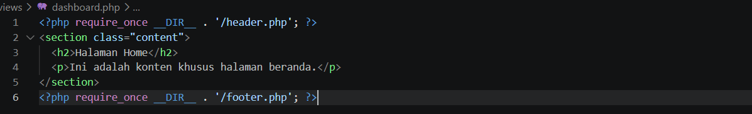

5. Membuat halaman about.php

   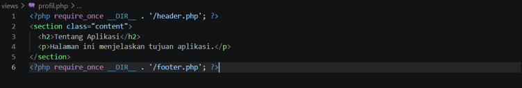

6. Membuat style.css

   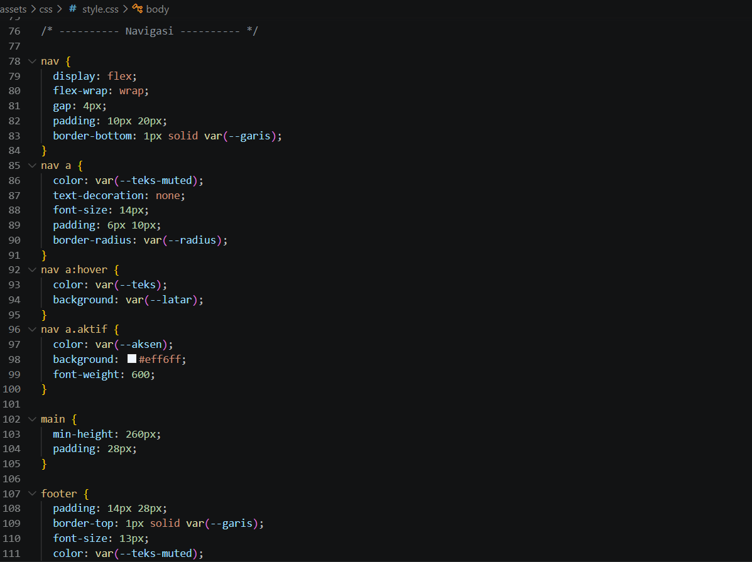

## Analisis hasil :

Bagian yang digunakan bersama oleh semua halaman adalah header, navigasi, footer, dan file CSS. Jika teks navigasi diubah di header.php, perubahan langsung tampil di seluruh halaman karena semua halaman dimuat melalui template yang sama.

Konten halaman tidak diletakkan seluruhnya di header karena header hanya berisi bagian yang sama untuk semua halaman. Jika konten ikut berada di header, setiap halaman baru harus menyalin dan mengubah header, sehingga manfaat pemisahan hilang.

require_once lebih baik daripada menyalin kode header ke setiap halaman karena kode hanya ada di satu file.

Perubahan cukup dilakukan sekali, dan file tidak dimuat ulang jika sudah pernah dimuat.

## Function pada PHP

### Latihan function :

1. Buat function konversiCelciusKeFahrenheit($c) yang mengembalikan hasil konversi.

   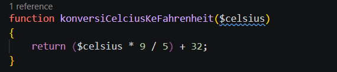

   konversiCelciusKeFahrenheit() dibuat dan mengembalikan hasil konversi. Contoh 30 °C menghasilkan 86 °F.

2. Buat function tentukanStatusNilai($nilai) yang mengembalikan predikat berdasarkan rentang nilai yang Anda tetapkan.

   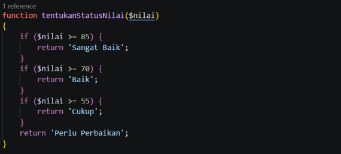

   tentukanStatusNilai() mengembalikan predikat: 85 ke atas Sangat Baik, 70 sampai 84 Baik, 55 sampai 69 Cukup, dan di bawahnya Perlu Perbaikan. Rentang ini ditetapkan sendiri.

3. Buat function hitungTotal($harga, $jumlah) yang mengembalikan total belanja.

   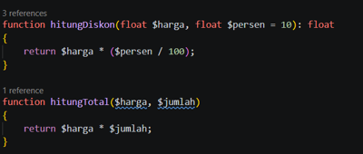

   hitungTotal() mengembalikan total dari harga dikali jumlah.

4. Pindahkan seluruh function ke file helpers.php dan panggil dari minimal dua halaman berbeda.

   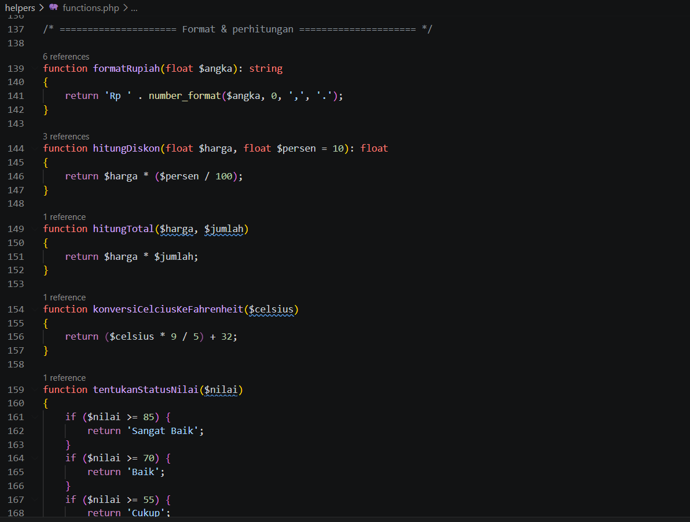

   disini dipanggil dihalaman home dan latihan fungsi

   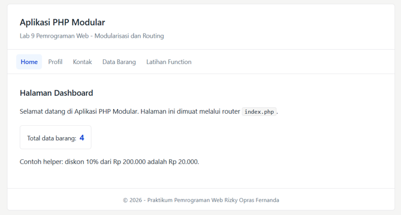

   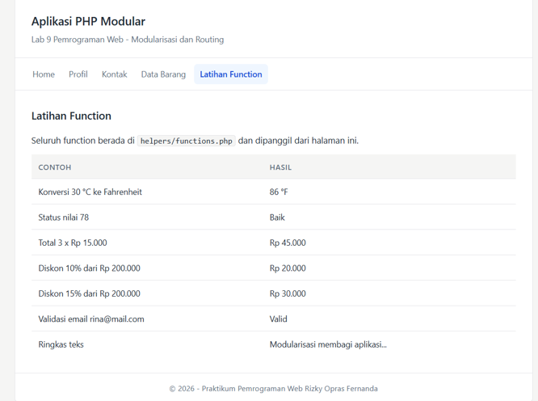

## Menata Struktur Direktori Aplikasi

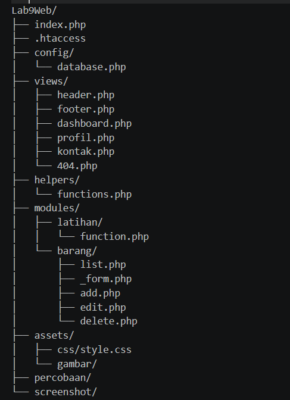

## Routing Sederhana dengan Parameter URL

1. Memahami parameter page

   Cara kerja router. Pengunjung membuka index.php?page=barang/list. Router membaca nilai page, memeriksa apakah nilai tersebut ada di array $routes, lalu memuat file yang sesuai. Jika tidak ada, status HTTP 404 dikirim dan views/404.php dimuat.

2. Implementasi router dengan whitelist

   Whitelist rute yang dipakai

   | Parameter page   | File yang dimuat             |
   | ---------------- | ---------------------------- |
   | dashboard        | views/dashboard.php          |
   | profil           | views/profil.php             |
   | kontak           | views/kontak.php             |
   | latihan/function | modules/latihan/function.php |
   | barang/list      | modules/barang/list.php      |
   | barang/add       | modules/barang/add.php       |
   | barang/edit      | modules/barang/edit.php      |
   | barang/delete    | modules/barang/delete.php    |

   Keamanan. Nilai page tidak pernah digunakan sebagai path file. Router hanya memuat file dari array whitelist. Jika page disusun dari input seperti require $\_GET['page'] . '.php', pengunjung dapat mencoba path traversal atau memuat file yang tidak dimaksudkan. Nilai page yang berupa array juga ditolak karena hanya string yang diterima.

   Urutan pemrosesan. Konten dimuat lebih dulu di dalam output buffer (ob_start()), baru kemudian header dan footer dicetak. Urutan ini diperlukan karena modul add, edit, dan delete perlu melakukan redirect dengan header() setelah memproses data. Redirect tidak dapat dilakukan setelah HTML sudah dikirim.

3. Contoh file modul

   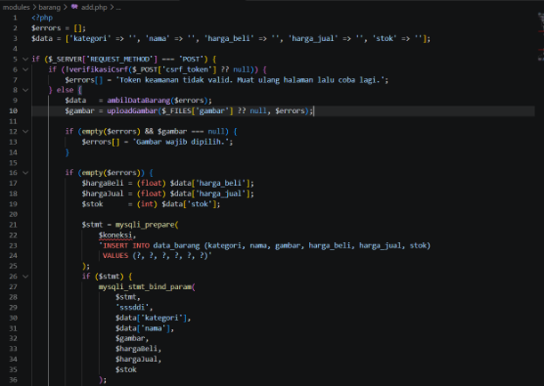

4. Menambahkan halaman 404

   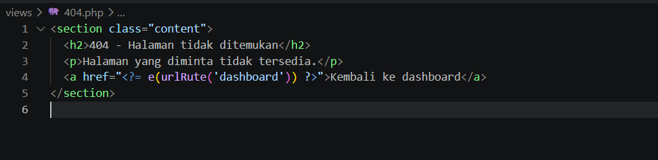

5. Menguji routing
   - Buka http://localhost/Lab9Web/index.php dan pastikan dashboard tampil.

     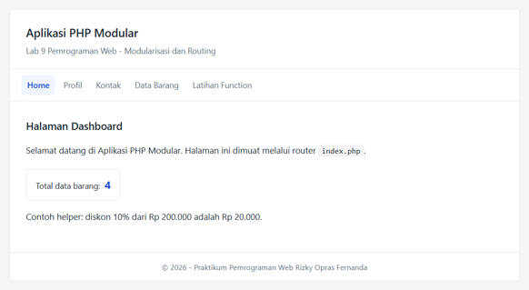

   - Buka index.php?page=barang/list dan pastikan modul daftar barang tampil.

     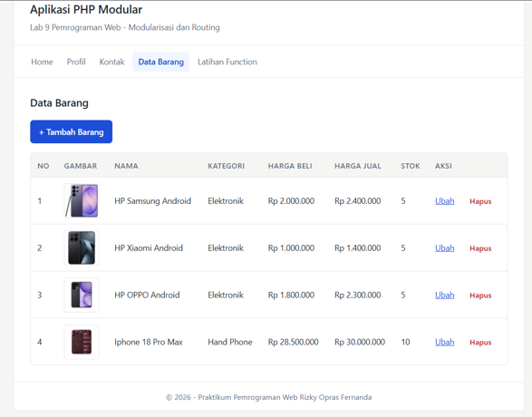

   - Buka http://localhost/Lab9Web/index.php?page=barang/add dan pastikan form tambah pengguna tampil.

     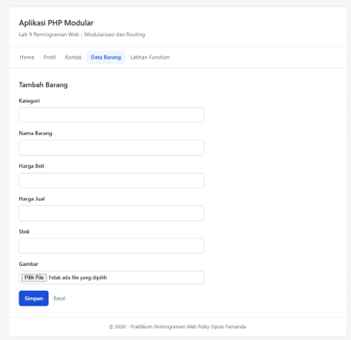

   - Coba parameter page yang tidak terdaftar, misalnya page=admin/rahasia. Aplikasi harus menampilkan halaman 404.

     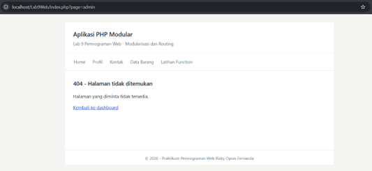

   - Coba parameter page kosong dan parameter yang tidak sesuai tipe. Pastikan aplikasi tetap menangani permintaan dengan aman

     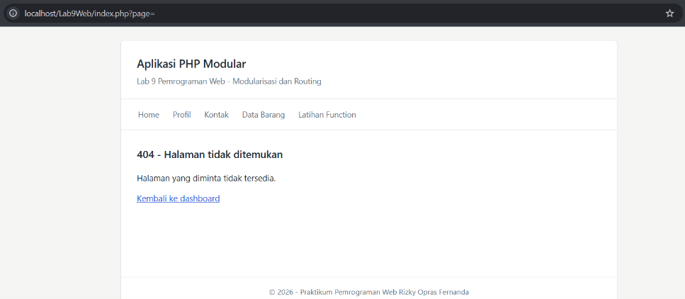

## URL Lebih Ringkas dengan .htaccess (Opsional)

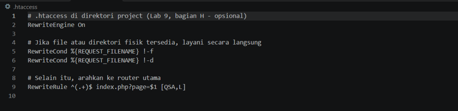

Pengujian. Buka http://localhost/Lab9Web/barang/list. Jika muncul 404 dari Apache, periksa apakah mod_rewrite aktif di httpd.conf, apakah AllowOverride All sudah diatur untuk folder htdocs, dan apakah file .htaccess berada di folder Lab9Web.

## Integrasi dengan Aplikasi Database Praktikum Sebelumnya

Pada project ini sudah dihubungkan dengan praktikum 8 yaitu data barang

## Pertanyaan Pemahaman

1. Jelaskan pengertian modularisasi program dan minimal tiga manfaatnya.

   Modularisasi adalah membagi aplikasi menjadi bagian kecil berdasarkan fungsi atau tanggung jawab.

   Manfaatnya:
   - kode dapat digunakan ulang
   - perubahan terlokalisasi pada satu modul
   - dan pekerjaan tim dapat dibagi per modul

2. Apa perbedaan include dan require ketika file yang dipanggil tidak ditemukan?

   include menghasilkan peringatan dan eksekusi berlanjut.

   require menghasilkan fatal error dan eksekusi berhenti. Untuk file wajib seperti konfigurasi database, require lebih tepat karena aplikasi tidak boleh berjalan tanpa koneksi.

3. Mengapa require_once sesuai untuk konfigurasi database. Konfigurasi wajib tersedia dan hanya perlu dimuat satu kali. require_once memastikan koneksi tidak dibuat dua kali, dan error fatal muncul jika file hilang sehingga masalah langsung terlihat.

4. Perbedaan parameter, argumen, dan nilai return. Parameter adalah variabel pada deklarasi function. Argumen adalah nilai yang dikirim saat pemanggilan. Nilai return adalah hasil yang dikembalikan function melalui return.

5. Mengapa header dan footer dipisahkan dari konten. Header dan footer sama untuk setiap halaman, sedangkan konten berbeda. Dengan pemisahan ini, perubahan tampilan cukup dilakukan sekali.

6. Fungsi index.php pada pola routing. index.php menjadi satu pintu masuk. Ia membaca parameter page, memeriksa apakah rute diizinkan, lalu memuat file yang sesuai dengan header dan footer.

7. Mengapa router sebaiknya menggunakan whitelist. Whitelist memastikan hanya file yang sudah ditentukan yang dapat dimuat. Permintaan ke rute lain menghasilkan 404, sehingga file internal tidak terbuka secara tidak sengaja.

8. Risiko jika input page langsung digabungkan menjadi path file. Pengunjung dapat menyusun nilai seperti ../../config/database untuk membuka file di luar yang diizinkan, atau memuat file yang tidak dimaksudkan untuk diakses langsung. Ini disebut path traversal.

9. Fungsi RewriteCond dan RewriteRule. RewriteCond menentukan syarat, dalam hal ini permintaan bukan file atau direktori fisik. RewriteRule menentukan perubahan URL, yaitu meneruskan permintaan ke index.php?page=... Ketika syarat terpenuhi.

10. Bagian CRUD yang tepat dipindahkan ke config, views, helpers, dan modules. Koneksi mysqli_connect dipindahkan ke config. Header, navigasi, dan footer dipindahkan ke views. Fungsi e(), formatRupiah(), uploadGambar(), dan validasi input dipindahkan ke helpers. Halaman list, tambah, ubah, dan hapus dipindahkan ke modules/barang.
